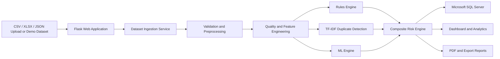
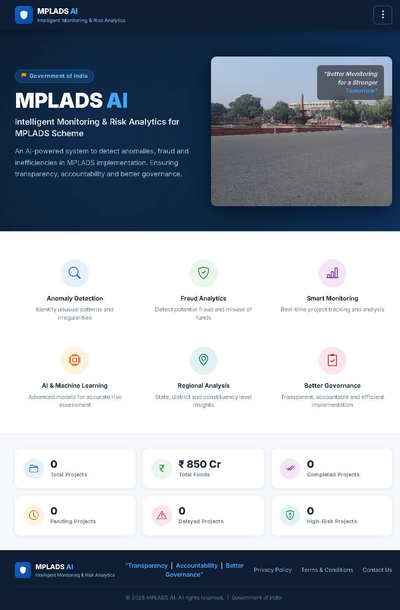
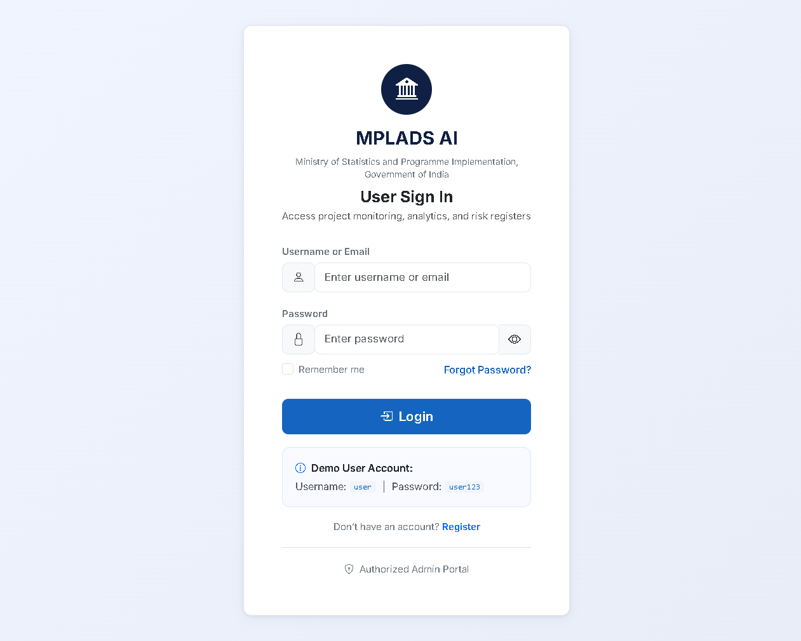

# MPLADS AI Monitoring System

MPLADS AI Monitoring System is a web-based audit and analytics platform for monitoring Members of Parliament Local Area Development Scheme projects. It combines deterministic compliance rules, data-quality checks, duplicate-work detection, and machine learning anomaly models to identify financial, implementation, geographic, and administrative risk indicators that require further verification.

The system provides an executive dashboard, project-level risk explanations, dataset management, alerting, report exports, and administration tools. It is designed to support transparent and accountable MPLADS implementation; ML outputs are presented as risk indicators, not confirmed fraud.

## Features

- CSV/XLSX/JSON dataset upload and canonical-column mapping
- Data validation, quarantine, cleaning, and quality scoring
- Executive KPIs, charts, regional analytics, and project drill-down
- Cost-overrun, delay, efficiency, and progress-versus-spend analysis
- Rule-based anomaly detection for financial and implementation irregularities
- Duplicate work detection using TF-IDF and cosine similarity
- Isolation Forest, One-Class SVM, and Random Forest model comparison
- Composite 0-100 risk score with Low, Medium, High, and Critical tiers
- Explainable risk reasons for every flagged project
- Dataset-scoped analysis and persisted ML/model outputs
- PDF reporting, Power BI export datasets, and Excel-compatible reporting
- User registration/login, administrator portal, alerts, audit logs, and investigation notes

## Technologies Used

| Layer | Technology |
|---|---|
| Web application | Python, Flask |
| Authentication | Flask-Login, Werkzeug password hashing |
| Database | Microsoft SQL Server, SQLAlchemy, PyODBC |
| Data processing | Pandas, NumPy, OpenPyXL |
| Machine learning | scikit-learn |
| Model persistence | Joblib |
| Frontend | HTML5, CSS3, Bootstrap 5, Bootstrap Icons, JavaScript |
| Charts | Chart.js |
| Reports | ReportLab |
| Testing | Pytest |
| Production server | Gunicorn |

## System Architecture



The end-to-end pipeline executes validation, cleaning, quality evaluation, feature engineering, policy rules, duplicate detection, model inference/training, composite scoring, efficiency analysis, and export generation. Results are cached in `data/processed/cache/pipeline_cache.joblib` for faster subsequent page loads.

## Database Design

The application uses SQL Server by default through `MPLADS_AI_DB`. SQLAlchemy partitioning fields isolate projects and analysis results by `dataset_id`.

Main entity groups:

| Entity | Purpose |
|---|---|
| `User`, `ActiveUserSession` | Account authentication and active-session tracking |
| `Dataset`, `DataUpload` | Dataset metadata and upload history |
| `MP`, `District`, `Agency` | Administrative dimensions |
| `Project` | Canonical project, financial, progress, geographic, and schedule fields |
| `FinancialRecord`, `ImplementationRecord` | Dataset-scoped financial and implementation history |
| `DataValidationResult`, `DataQualityResult` | Validation and quality audit output |
| `AnomalyResult`, `DuplicateResult` | ML/model and duplicate-work findings |
| `RiskScores` | 0-100 composite scores, levels, and risk dimensions |
| `Alert`, `InvestigationNote` | Alert workflow and audit investigation notes |
| `AuditLog`, `SystemSetting` | System activity and configuration |

The `Dataset` entity is the primary dataset boundary. Related records carry `dataset_id`, allowing uploaded datasets, synthetic datasets, findings, and risk results to remain isolated.

## Machine Learning Techniques

### Feature Engineering

The pipeline creates financial, temporal, spatial, progress, utilization, cost-overrun, and data-consistency features. Numerical features are standardized with `StandardScaler` before model evaluation.

### Anomaly and Risk Models

- **Isolation Forest:** Unsupervised tree-based isolation of records that differ from the normal baseline.
- **One-Class SVM:** Unsupervised RBF-kernel boundary model for outlier detection.
- **Random Forest:** Supervised balanced classifier trained on available ground-truth labels or fallback rule-derived calibration labels.
- **GridSearchCV:** Tunes model parameters using stratified holdout or cross-validation.
- **TF-IDF n-grams and cosine similarity:** Detects duplicate work descriptions within the same district and work category at a configured 80% similarity threshold.

### Composite Risk Scoring

The project score combines normalized model and rule components:

- Isolation Forest: 25%
- One-Class SVM: 20%
- Random Forest: 35%
- Deterministic rules: 20%

Scores are classified as:

- `Low`: 0-39
- `Medium`: 40-59
- `High`: 60-79
- `Critical`: 80-100

The system also generates plain-language, verification-oriented reasons for financial, timeline, duplicate, and machine-learning indicators.

## Installation

### Prerequisites

- Windows or a compatible Python environment
- Python 3.10 or later
- Microsoft SQL Server and an ODBC SQL Server driver
- Git

### 1. Clone the repository

```powershell
git clone <repository-url>
cd MPLADS-AI-Monitoring-System
```

### 2. Create and activate a virtual environment

```powershell
py -m venv .venv
.\.venv\Scripts\Activate.ps1
```

### 3. Install dependencies

```powershell
pip install --upgrade pip
pip install -r requirements.txt
```

### 4. Configure the database

The default configuration uses Windows trusted authentication for SQL Server database `MPLADS_AI_DB` on `localhost`.

Configure a different SQL Server instance or use a SQLAlchemy connection URL:

```powershell
$env:SQL_SERVER_HOST = "localhost"
$env:SQL_SERVER_DB = "MPLADS_AI_DB"
$env:DATABASE_URL = "mssql+pyodbc:///?odbc_connect=<encoded-odbc-string>"
$env:SECRET_KEY = "<secure-random-secret>"
```

The application creates tables and seeds the demo accounts at startup.

### 5. Run the application

```powershell
python run.py
```

Open `http://127.0.0.1:5000`.

### Demo accounts

| Role | Username | Password |
|---|---|---|
| User | `user` | `user123` |
| Administrator | `admin` | `admin123` |

Demo credentials are intended for local development. Change or remove seeded credentials before public deployment.

### Run tests

```powershell
pytest
```

## Screenshots

The following screenshots are captured from the actual locally rendered application.

### Landing Page



### User Login



Additional dashboard, ML detection, duplicate analysis, and report screenshots can be added to `screenshots/` after loading a demo dataset and logging in.

## Deployment

**Deployment URL:** Not hosted yet. Add the public HTTPS URL here after deployment.

For a Gunicorn deployment:

```powershell
gunicorn --bind 0.0.0.0:8000 run:app
```

Before deployment:

1. Set a strong `SECRET_KEY`.
2. Replace demo credentials and disable insecure development defaults.
3. Configure SQL Server connectivity and network/firewall access.
4. Set `DATABASE_URL` using a secret-backed connection string.
5. Run `pytest` and perform an HTTPS/security configuration review.
